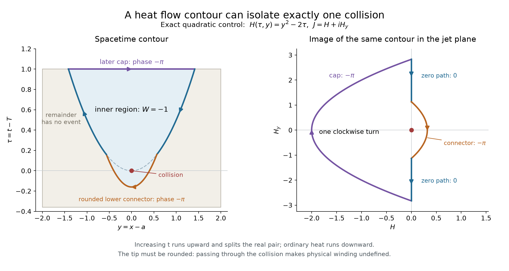

# Heat flow contours, collision patches, and Gaussian cap energy

20 October 2026, America/New_York. Prepared for **Edward Baker** with
substantial LLM assistance. Model **gpt-6-astra (Codex)**, actual reasoning
effort **ultra**, verified from recorded turn metadata.

**Status: exact contour and energy identities proved in-note; no new
theta sign estimate or event exclusion.** Edward Baker proposed the term
“heat flow contour,” taking diffusion seriously, and splitting the domain
into a curved triangle enclosing the collision and its complement. This
note assesses that proposal and records two concrete estimating options.
The [result index][results], [geometry][geometry], [control screen][controls]
and [avoid index][avoid], especially [reformulations][a01], [control
premises][a02], [scope][a07] and [volume without gain][a20], apply.

## 1. Terminology, time direction, and propagation

Use **heat flow contour** henceforth; **parabolic heat flow contour**
specifies a square-root opening. Earlier “light cone” wording remains a
historical description of the proposal, not a finite-propagation claim.

The physical family satisfies \(H_t=-H_{xx}\). Thus
\(u(s,y)=H(T-s,a+y)\) satisfies the ordinary heat equation \(u_s=u_{yy}\):
ordinary diffusion runs toward decreasing physical \(t\). At an ordinary
event \(h_0=h_1=0,\ h_2\ne0\), with \(h_j=\partial_x^jH(T,a)\),

\[
 H(T+\tau,a+y)
 =h_2(y^2/2-\tau)+h_3(y^3/6-\tau y)
       +O_{\rm par}(4).
\]

Here the remainder has parabolic weight at least four. Local analytic
root expansions give

\[
 x_\pm(T+\tau)
 =a\pm\sqrt{2\tau}+\frac{2h_3}{3h_2}\tau+O(\tau^{3/2}),
 \qquad \tau>0.                                      \tag{1}
\]

For \(\tau=-\sigma<0\) the pair instead has leading locations
\(a\pm i\sqrt{2\sigma}\). Consequently the two real paths lie above \(T\)
in a diagram with increasing physical time upward; they collide when
followed downward. The pre-event complex paths are not real spacetime
walls.

The Gaussian heat kernel is positive at every real spatial point after
any positive diffusion time. The scale \(|x-a|\sim\sqrt{|t-T|}\) is a
diffusive scale, not a characteristic boundary. See
[Nolen's diffusion notes, §2.7](https://math.stanford.edu/~ryzhik/STANFORD/STANF227-11/notes227-09.pdf).
Zero paths are level-set trajectories, not heat-particle paths. Their
velocity, where simple, is \(x'=H_{xx}/H_x\).

Ordinary heat flow permits a signed lobe between two zeros to disappear
at a collision. It does not require an earlier collision creating that
lobe: the lobe may already be in the supplied initial data. The exact
quadratic has only one event for all real times and rules out such an
inference from the heat equation alone.

## 2. The proposed split is valid with an enclosed collision

If a collision patch \(C\) is inside \(\Omega\), with \(J=H+iH_x\ne0\)
on every contour used, index additivity gives

\[
 W_J(\partial\Omega)
 =W_J(\partial C)
       +W_J\bigl(\partial(\Omega\setminus\overline C)\bigr).     \tag{2}
\]

Every component has its induced orientation; shared arcs cancel.
An isolated ordinary collision contributes \(-1\). If the complementary
region contains no zero of \(J\), its **total boundary degree** is zero.
When the complement is an annulus this does not make its phase
single-valued: each loop around the hole can still have winding \(-1\).
Their contributions cancel only because the inner boundary has opposite
orientation. A partition whose patch shares an outer cap can instead
have simply connected complementary pieces; its internal cuts still
need both orientations.

A root-bounded triangle with the collision precisely at its tip has
\(J=0\) on its boundary, so its physical winding is undefined. Round the
tip below \(T\) to enclose the event, or truncate and add the paid local
index, or use the established regularization \(Z=J/L\). A forward
regularized root triangle with no additional event has degree zero, not
physical degree \(-1\).

### Exact rounded triangle

For \(H=y^2-2\tau\), choose \(0<\eta<R\). Use the two root walls
\(y=\pm\sqrt{2\tau}\) for \(\eta\le\tau\le R\), a top cap at \(R\),
and the lower connector
\[
 \tau=y^2-\eta,\qquad
 y:\sqrt{2\eta}\ \longrightarrow\ -\sqrt{2\eta}.
\]
Orient by \(dt\wedge dx\), so the top cap runs left to right.

On each simple root wall \(J=iH_x\) has constant phase, contributing
zero. The cap between the adjacent roots contributes \(-\pi\), by
[Note 03][n3]. On the lower connector
\[
 H=2\eta-y^2>0
\]
in its interior; \(J\) runs in the right half-plane from the positive to
the negative imaginary axis, contributing exactly \(-\pi\). Hence
\[
 \Delta\arg J=-\pi+0-\pi+0=-2\pi,\qquad W_J=-1.      \tag{3}
\]
An enclosing rectangle with the same top time has \(H>0\) in the
complement's interior and no extra event. Thus the proposed split is
realized exactly without contradiction or later collision.

The [plot source][plot] uses \(R=1,\eta=0.16\). The image illustrates the
analytic calculation, not a numerical theta certificate. Arrows on the
spacetime contour follow the \(dt\wedge dx\) convention.

## 3. A nonzero level contour simplifies the curved side

Normalize \(F=H/h_2\), which leaves winding unchanged, and choose a small
\(e>0\). Since \(F_\tau(0,0)=-1\), a local level arc
\[
 F(\tau,y)=e
\]
has leading shape \(\tau=y^2/2-e\). Close a simple connected portion by a
horizontal cap at \(\tau=R\), provided that it is below that cap, has
exactly the two intended endpoints, and forms a Jordan curve enclosing
the initial event. Global continuation of this arc is a separate
obligation.

On the curved side \(J/h_2=e+iF_y\), so nonvanishing is automatic and
the continuous phase stays in the right half-plane. The bound
\(|J|\ge |h_2|e\) is event-dependent, not a uniform curvature floor.
If the cap has
\(N\) simple interior zeros, its endpoint values of \(F\) equal \(e>0\),
so \(N\) is even. With endpoint principal phases
\(\theta_-,\theta_+\) of the normalized jet \(J/h_2\),
partitioning at those zeros gives
\[
 \Delta_{\rm cap}\arg J=\theta_+-\theta_- -N\pi,
 \qquad
 \Delta_{\rm level}\arg J=\theta_- -\theta_+.
\]
Therefore
\[
                         W_J=-N/2.                \tag{4}
\]

This is an actual boundary simplification: the entire curved side needs
only its endpoint arguments. If the only possible earlier event is the
initial ordinary collision, index additivity gives \(N=2+2K_{\rm later}\).
The usual value \(N=2\) is fully consistent. Forcing \(N\ge4\) still
requires a new cap estimate.

The level curve can cease to be a graph \(\tau=\tau(y)\) when
\(F_{yy}=0\), even while
\(J\ne0\); that is not a collision. Likewise general constant-phase walls
solve
\[
 x'=\frac{Q_x}{Q},\qquad Q=H_x^2-HH_{xx},
\]
where \(Q\ne0\). Simple zero walls and nonzero nondegenerate critical
walls are special cases. Such choices remove wall phase, but require
their own continuation and all cap/connector payments. At \(Q=0\) the
graph coordinate may fail without a zero of \(J\).

## 4. Literal diffusion gives complete Gaussian cap identities

For \(s>0\), define
\[
 G_s(y)=\frac{1}{\sqrt{4\pi s}}e^{-y^2/(4s)},\qquad
 f(y)=H(T+s,a+y).
\]
The complete theta cosine source gives, exactly,
\[
 \int_{\mathbb R}G_s f\,dy=h_0,\qquad
 \int_{\mathbb R}G_s f'\,dy=h_1
       =\int_{\mathbb R}\frac{y}{2s}G_s f\,dy.       \tag{5}
\]
Indeed Gaussian convolution multiplies a source frequency \(u\) by
\(e^{-su^2}\), changing \(e^{(T+s)u^2}\Phi(u)\) back to
\(e^{Tu^2}\Phi(u)\). The source and all finite moments are integrable
on every compact time interval, bounding \(H\) and its finite
derivatives on the real line and justifying Fubini and integration by
parts.

At a double event both Gaussian moments vanish. Orthogonality to the
constant and linear functions with positive weight requires at least
two global sign changes, but supplies no surplus over the original pair.
The quadratic satisfies both cancellations exactly.

There is no unpaid finite heat cone in (5). For the quadratic, the
root wedge \(|y|<\sqrt{2s}\) retains only
\(\operatorname{erf}(1/\sqrt2)\), approximately \(68.27\%\), of Gaussian
mass, independently of \(s\). For the normalized model
\(f=h_2(y^2/2-s)\), its signed Gaussian integral inside that wedge is
\(-2h_2s\,e^{-1/2}/\sqrt{2\pi}\), and the exterior contributes precisely
the opposite amount. The exterior cannot be discarded even near the
apex. A wider fixed cutoff requires explicit Gaussian-tail payments.

Heat-kernel level contours are another natural geometry:
\[
 G_\tau(y)=(4\pi A)^{-1/2}
 \quad\Longleftrightarrow\quad
 y^2=2\tau\log(A/\tau),\quad0<\tau<A.
\]
They organize heat mean-value identities, as described in
[McCuan's heat-equation notes](https://mccuan.math.gatech.edu/courses/6702/heateqn.pdf).
They are neither constant-phase curves nor boundaries of finite
influence.

## 5. A sharp Gaussian energy inequality on one later cap

The two cancellations in (5) imply
\[
 \boxed{\displaystyle
 \int G_s f^2\le s\int G_s(f')^2
                 \le 2s^2\int G_s(f'')^2.}        \tag{6}
\]
This is the Gaussian Poincare inequality with the constant and linear
modes removed. It needs the double-event hypothesis, but not the
all-real threshold hypothesis.

For a proof and a precise comparison, expand
\[
 f(\sqrt{2s}\,z)=\sum_{n\ge0}c_n\operatorname{He}_n(z)
\]
in probabilists' Hermite polynomials, with
\(\mathbb E[\operatorname{He}_n(Z)\operatorname{He}_m(Z)]
 =n!\,\mathbf1_{m=n}\) for a standard Gaussian \(Z\).
Gaussian integration by parts and (5) applied to derivatives give
\[
 c_n=\frac{(2s)^{n/2}}{n!}\,h_n.
\]
The bounded theta cap and its derivatives lie in the required Gaussian
Sobolev spaces. Parseval and the derivative norm identity give
\[
 \int G_s f^2=\sum_{n\ge0}n!c_n^2,\qquad
 s\int G_s(f')^2=\frac12\sum_{n\ge1}n\,n!c_n^2.
\]
At an event \(c_0=c_1=0\), which proves the first inequality in (6).
Ordinary Gaussian Poincare for \(f'\), whose mean is zero, proves the
second.

Define the signed cap deficit
\[
 D_s:=s\int G_s H_x(T+s,a+y)^2\,dy
               -\int G_s H(T+s,a+y)^2\,dy.
\]
The exact convergent identity, valid without an event assumption, is
\[
 D_s=-h_0^2-sh_1^2
       +\sum_{n\ge3}\frac{n-2}{2}\frac{(2s)^n}{n!}h_n^2.       \tag{7}
\]
In particular, a complete bound \(D_s\le-\delta<0\) would prove
\[
                  h_0^2+s h_1^2\ge\delta,          \tag{8}
\]
quantitatively excluding the initial common zero. It would not itself
force a later collision. A fixed cap needs only \(H,H_x\), including
complete integration and spatial-tail errors.

At an event, equality in the first inequality of (6) holds only for
\(f\) proportional to \(y^2-2s\). Thus a nonzero bounded theta cap would
actually have \(D_s>0\) under the hypothetical event; no uniform
positive margin follows. The quadratic control has \(D_s=0\). The
exact cubic control of [Note 01][n1] gives
\[
                         D_s=\frac23h_3^2s^3\ge0.              \tag{9}
\]
These are exact substitutions, not numerical theta observations.

There is also a bounded positive-source control, for any fixed \(T_0>0\):
\(H(t,x)=1+e^{t-T_0}\cos x\). Its actual all-real threshold is \(T_0\),
with an ordinary event at \((T_0,\pi)\) and no later collision: the
zero equation is \(\cos x=-e^{T_0-t}\). Its centered
cap is \(f(y)=1-e^s\cos y\), and direct Gaussian integration gives
\[
 D_s=1+s\sinh(2s)-\cosh(2s)>0\quad(s>0).
\]
Indeed \(D_0=D'_0=0\) and \(D''_s=4s\sinh(2s)>0\). This source consists
of positive atoms at frequencies zero and one; it is not theta and has
simultaneous periodic threshold events. It shows that even strict
positivity in the Gaussian event inequality is compatible with the
threshold mechanism, rather than supplying a contrary sign.

For a complete-source implementation, put
\(w(u)=e^{(T+s)u^2}\Phi(u)\). Product-to-sum and Gaussian integration yield
\[
\begin{split}
 D_s=\frac12\int_0^\infty\!\!\int_0^\infty w(u)w(v)
 \bigl[&(suv-1)e^{-s(u-v)^2}\cos(a(u-v))\\
       &-(suv+1)e^{-s(u+v)^2}\cos(a(u+v))\bigr]\,du\,dv .
\end{split}                                                       \tag{10}
\]
This retains the signed two-source correlation; replacing both terms
by separate absolute allowances can erase the desired margin.

**Classification.** A non-event point has \(D_s<0\) for sufficiently
small \(s\), whereas an event has \(D_s\ge0\). Allowing an unspecified
adaptive \(s\) therefore only reformulates first-jet nonvanishing.
A substantive task must fix a useful positive \(s\), parameter window,
complete-source estimator and error budget, then compare a measured
strict margin with the strongest direct Gaussian-moment or first-jet
consumer using the same data. Neither a successful theta window nor a
cost advantage is obtained here.

## 6. Other heat balances and the continuation decision

Literal heat transport also gives
\[
 \frac d{dt}\int_{\ell(t)}^{r(t)}H\,dx
       =H_x(t,\ell(t))-H_x(t,r(t))
\]
between simple root walls. For adjacent roots, the lobe's magnitude
grows with physical \(t\), hence decays in ordinary heat time. This
does not force another event.

For \(E=H^2+H_x^2\) the Gaussian Bochner balance is
\[
 \int G_s E(T+s,a+y)\,dy
 =E(T,a)+2\int_0^s\!\int G_r(y)
       (H_x^2+H_{xx}^2)(T+r,a+y)\,dy\,dr.           \tag{11}
\]
It follows from \(E_t+E_{xx}=2(H_x^2+H_{xx}^2)\). At the quadratic
event both sides after removing \(E(T,a)=0\) equal
\(2h_2^2(s+s^2)\). Merely subtracting the two integrals recovers
\(E(T,a)\); that identity alone is a reformulation rather than an
additional exclusion estimate.

The [nonpolynomial control premises in Note 05][n5] remain in force.
The Gaussian inequalities apply to every admissible cosine source
with an exact common zero, including the positive atomic and
finite-profile controls. Weighted-square and finite-prime events
need no invented all-real threshold for (6). Euler-factor, reflected
and primitive-compatible controls likewise obey the event identity
when its premises are actually supplied. None has the unchanged full
theta arithmetic source. Geometry and generic heat identities cannot
distinguish theta from those controls.

**Decision:** adopt the terminology, use an enclosed collision patch
with exact shared-boundary accounting, and retain two estimating
options: a nonzero \(H/h_2\) level arc for simpler physical winding,
and the fixed Gaussian cap deficit (7) for direct event exclusion.
The latter complements BW-05 but has a different conclusion and
sign obligation. Zero-interaction energy remains a separate tool
requiring its full real-root and renormalization hypotheses. No new
theta estimate, extra winding, or prior/later collision has been forced.

[results]: ../../../../../../../result-summaries/README.md
[geometry]: ../../../../../../../result-summaries/13_local_heat_flow_geometry_and_rh_equivalent_criteria.md
[controls]: ../../../../../../../result-summaries/12_collision_controls_and_screening.md
[avoid]: ../../../../../../../avoid/README.md
[a01]: ../../../../../../../avoid/01_restating_the_target.md
[a02]: ../../../../../../../avoid/02_shape_only_arguments_and_the_controls.md
[a07]: ../../../../../../../avoid/07_scoped_exclusions_read_as_universal.md
[a20]: ../../../../../../../avoid/20_volume_without_a_gain.md
[n1]: 01_FINITE_CONTOUR_AND_SOURCE_CONTRACT_20261020.md
[n3]: 03_ROOT_FOLLOWING_WALLS_AND_CAP_COUNT_20261020.md
[n5]: 05_TOPOLOGICAL_ALTERNATIVES_AND_ENERGY_OBSERVATIONS_20261020.md
[plot]: ../numerics/plot_heat_flow_lens.py
