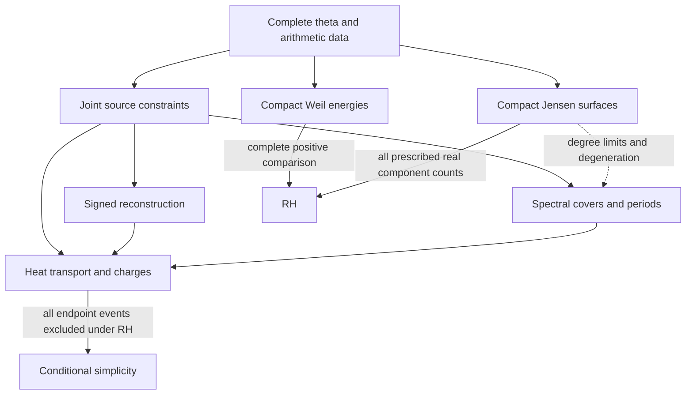

# Compact geometry heat transport and Weil positivity

21 October 2026, America/New_York. Prepared for **Edward Baker** with
substantial LLM assistance. Actual recorded model **gpt-6-astra (Codex)**,
reasoning effort **max**, verified from the active turn metadata.

**Opening brainstorm for Investigations 4.** This is the common starting
point for the network of ideas developed in the founding conversation:
theta geometry, parallel transport, heat evolution, topological charge,
spectral covers and periods, compact real surfaces, finite-time signed
reconstruction, and the return to finite-interval Weil positivity.
It supplies the material for a later README, research overview and focused
project folders. The proposed organization below is provisional.

The organizing question is whether the complete arithmetic source admits
a geometric or transported observation whose sign is easier to establish
than in the current coordinates. A useful answer must yield a new
applicable estimate, a faithful diagnostic with a demonstrated benefit,
or a precisely scoped obstruction. The existing identities and criteria
are inputs to that work, with their recorded limitations intact.

## 1 Two mathematical goals and one estimating goal

The conversation began in an RH-conditional simplicity investigation and
then returned to RH itself through the Weil form and compact surfaces.
The new program needs to keep those goals explicit.

| Goal | What would establish it | What does not establish it |
| --- | --- | --- |
| RH through Weil positivity | Nonnegativity of the complete central Weil form on every smooth compactly supported complex test, equivalently on arbitrarily large finite support intervals. | A finite list of positive windows, positivity of one factor, or a positive auxiliary state space without the arithmetic identification. |
| RH through compact real surfaces | The prescribed maximal real-component count for every surface in the canonical odd-degree Jensen family. | Complex genus alone, finitely many degrees, or eventual regularity at a separately chosen auxiliary heat time for each degree. |
| Simplicity conditional on RH | Exclusion of every possible endpoint multiple zero, with all heights and multiplicities covered. | RH alone, a finite separated-pair certificate, or simple roots of every finite Jensen approximant. |
| A useful estimating milestone | A proved improvement to a declared signed enclosure or acquisition cost, with the same complete data and errors accounted for. | An exact rewriting, smaller error bars that still contain the hypothetical event, or a comparison that gives one method more information. |

The first two are equivalent formulations of RH. The third is stronger
than RH as a target. The fourth can be meaningful without solving either
global problem. See the [project target][root], [result index][results],
and the rule on [classifying criteria][a01].

## 2 Shared objects and parameters

The complete physical field is

\[
 H(t,z)=\int_0^\infty\Phi(u)e^{tu^2}\cos(zu)\,du,
 \qquad H_t=-H_{zz},\qquad
 H(0,z)=\tfrac18\xi(\tfrac12+\tfrac{iz}{2}).
 \tag{1}
\]

The theta source, its complete transform H, and an auxiliary polynomial
approximation are different objects. The relevant geometric structures
also have different bases and transport laws.

| Object | Information it retains | Parameter that must stay explicit |
| --- | --- | --- |
| Complete theta source and marked elliptic theta family | Canonical coefficients, modular reflection, source moments and coupled tails. | Source cutoff and reflection order. |
| Heat jet G=(H,H_z) and its normalized direction | Common zeros, phase connection and boundary charge. | Physical heat time and complex spacetime boundary. |
| Two-root discriminant Delta=(z_1-z_2)^2 | Separation, collision and real versus conjugate-pair sign. | Heat time, root window and exterior unit. |
| Spectral cover w^2=H(t,z) | Root branching, transported cycles and periods. | Physical heat time, spatial cutoff and marked path. |
| Compact Jensen curve y^2=J_{2g+1}(x) | Real-component topology of a finite canonical moment model. | Degree; any auxiliary polynomial heat time is separate. |
| Central Weil form Q_{0,L} | The joint gamma, pole and prime contributions for support length L. | Support length, spectral resolution and zeta shift. |

Source cutoff, genus, support length, spectral resolution, zeta shift and
physical heat time cannot be substituted for one another. Each limiting
argument must name which parameter varies and what is held fixed.

## 3 The network of directions

The arrows below describe intended transfers of information. The arrows
to the global goals require the missing estimates stated in the text;
the diagram is not a chain of proved implications from source data alone.



Six project homes would keep the network broad but relatively shallow.
They are proposed names for a later organization step, not newly activated
research programs or replacements for the historical source folders.

### A Compact Weil energies and arithmetic spectral limits

**Possible home:** `01_compact_weil_positivity/`.

Return to the original all-support Weil problem, using a sequence of
closed compact spaces, potentially circles, equipped with an arithmetic
operator or energy. The desired mechanism is a nonnegative geometric
energy E_j and a source map I_j with, for each fixed compact test f,

\[
 Q_0[f]\ge E_j[I_jf]-\varepsilon_j[f],\qquad
 E_j[I_jf]\ge0,\qquad\varepsilon_j[f]\longrightarrow0.
 \tag{2}
\]

This would imply Weil positivity. A uniform positive spectral gap as
the compact spaces grow is not required. Equation (2) is a target
specification; it is not a new positivity estimate.

The [finite-horizon Weil work][weil] supplies the complete form and its
diagonal support/shift argument. [Connes–Consani circle models][cycles]
and [CCM spectral triples][ccm-paper] connect finite Weil data with
compact spectral geometry. The repository's [CCM work][ccm] already
investigated mechanical systems, strings, graph operators and spectral
limits. Its ground-state, arithmetic-identification and threshold gates
must carry forward. Hodge energies, Dirac constructions and global trace
pairings are possible tools only after the complete arithmetic map is
specified.

**First useful question:** can one identify a compact energy and prove
a one-sided comparison with the complete Weil form for fixed support,
including all seam, pole, prime and archimedean terms? A quantitative
comparison for an explicit candidate is the deliverable. A new
realization of an already positive finite pencil is not that comparison.

### B Complete theta source constraints

**Possible home:** `02_theta_source_constraints/`.

This supplies arithmetic information to the other five directions.
The source splits as Phi=S_m+R_m, but its finite head and tail are not
separately even. Complete reflection gives

\[
 S_m(v)-S_m(-v)=-\{R_m(v)-R_m(-v)\}.
 \tag{3}
\]

[BW14][bw14] has complete-tail Laplace representations, coupled
value/derivative bounds and finite-reflection error estimates. The
stronger reflection approximations reach a stated gamma-envelope scale;
that is not a relative lower bound for an unknown physical field or its
derivative. Reflection-only comparisons and comparisons against the
actual unchanged coefficients retain their recorded scopes.

The geometric version uses the marked elliptic theta line bundle and
its connection. Its physical source restriction can be flat even when
transverse commutators contain information. The task is to carry such
information through the full oscillatory transform with a paid signed
consequence, not to infer a sign from ambient curvature alone.

**First useful question:** can full reflection and canonical coefficients
produce a sharper joint feasible set for the few residual measurements
used by the collision response, or a signed constraint usable by a
compact Weil energy? Keep the head, tail and mixed terms correlated.
The priority and baseline are recorded in [BW12 Note 16][n16].

### C Heat transport and relative charges

**Possible home:** `03_heat_transport_and_charges/`.

For G=(H,H_z), wherever G is nonzero, put g=G/||G|| and
A=-i g^*dg. This is the induced phase connection on the line spanned
by G. The phase around a loop can change under heat flow, while the
integer charge on a closed three-dimensional spacetime boundary is

\[
 Q_\Omega=\frac1{4\pi^2}\int_{\partial\Omega}A\wedge dA.
 \tag{4}
\]

An isolated holomorphic heat event of spatial multiplicity m contributes
m(m-1)/2. The corresponding real-spacetime winding instead carries
weights floor(m/2); these are different observations. On the real
(t,z)-plane the particular complex phase form A vanishes, although real
jet winding can be nontrivial. The [connection note][n17],
[heat-evolution note][n18] and [manuscript][manuscript] fix conventions.

For a real shift of a complex heat window, the connection satisfies
dot A=d chi+J and dot(dA)=dJ. Its integer boundary charge stays constant
while the entire swept boundary avoids common zeros. Events entering
or leaving change the charge accordingly. A comparison of early and
late faces must retain every side face. Closing the boundary does not
remove the condition on the jet.

**First useful question:** can complete-source data control a swept
boundary or its full signed flux using information not captured by the
existing direct comparator? A later real slice of simple zeros is not
an independently established zero-charge complex window. The quantitative
endpoint windows are available conditionally at a hypothetical event;
the excluding signed estimate remains open.

### D Spectral covers periods and marked monodromy

**Possible home:** `04_spectral_covers_and_periods/`.

The cover w^2=H(t,z) turns colliding roots into singular fibers. A regular
path transports homology by the Gauss-Manin connection. A complex-time
loop around an ordinary double exchanges the two root labels; moving its
base point to later time conjugates the permutation and preserves its
cycle type. The marked loop is part of the data. It cannot simply be
replaced by a loop in a small late-time neighborhood.

Root permutations and homology monodromy need not detect the same thing.
The local two-branch-point cover is an annulus: its Dehn twist fixes the
sole absolute H_1 generator. Relative cycles, larger marked fibers and
periods may retain additional information. A nonzero cycle can have a
period tending to zero at a singular limit.

[BW13][bw13] already computed the first nodal-period correction. It
reduces to the existing event four-jet, so the same-information coefficient
comparison supplies no new exclusion. The direct entire-function cover
needs its finite boundary contract; compact algebraic approximants are
a separate construction.

**First useful question:** is there a finite-time or global source
constraint on a marked period, or on a collection of periods, beyond
that same-four-jet information? A useful result needs explicit paths,
normalization, source errors and a direct comparison. Generic cycle
transport alone permits the collision model.

### E Compact Jensen surfaces and degeneration

**Possible home:** `05_compact_jensen_surfaces/`.

For f(s)=xi(1/2+sqrt(s))=sum gamma_k s^k/k!, use
J_d(X)=sum binom(d,k)gamma_k X^k. The square-root notation denotes the
even entire series, and the coefficients are complete theta moments.
Let C_g be the smooth projective normalization of y^2=J_{2g+1}(x).
The inherited [compact-surface theorem][surfaces] states

\[
 \mathrm{RH}\ \Longleftrightarrow
 b_0(C_g(\mathbb R))=g+1\quad\text{for every }g\ge1.
 \tag{5}
\]

The real involution is essential. The expected count g+1 uses the
original polynomial degree, even if normalization lowers the actual
genus. Unmarked complex topology loses the real-root information.

The [surface-deficit identity][deficit] relates missing real components
to nonreal roots and repeated real roots. Its auxiliary polynomial heat
flow has a monotone deficit, but every fixed polynomial eventually
regularizes. A uniform degree-independent heat condition is already
RH-equivalent. That polynomial heat parameter is not the physical
heat time in (1).

The scaled polynomials J_d(s/d) converge locally uniformly to f.
Strictly real-rooted approximants can converge to a function with
multiple zeros, so (5) does not prove simplicity. [BW15][bw15] quantifies
local resolution and records a failed speed comparison for one specified
single-window acquisition. It leaves distinct period or shared-data
objectives outside that stop.

**First useful question:** can canonical theta arithmetic impose a
quantitative restriction on real-component loss, cycle degeneration or
cluster resolution that is not generic Jensen approximation? The sequence
of compact manifolds already exists; the missing advance is a useful
source estimate, not another topological reformulation.

### F Signed endpoint reconstruction and comparison

**Possible home:** `06_signed_reconstruction/`.

For an isolated two-root cluster, Delta=(z_1-z_2)^2 obeys

\[
 \Delta'=8+a\Delta,\qquad
 \Delta(0)=\mu(T)\Delta(T)-8\int_0^T\mu(s)\,ds,
 \qquad\mu(t)=\exp\!\left(-\int_0^t a(s)\,ds\right).
 \tag{6}
\]

This is affine transport: the forcing term remains. A homogeneous
augmented vector can stay nonzero while Delta vanishes. At the source
level H=F+E, the complete response is

\[
 \Delta_H=\Delta_F+L_F(E)+B_F(E,E)+R_3,
 \qquad |R_3|\le C_3(\rho).
 \tag{7}
\]

The [finite-time program][ftsr] and [progress record][ftsr-progress]
already provide a window without an assumed internal gap, a rank-at-most-
four quadratic response, and a canonical covariance enclosure. That
enclosure improves a specified uniform-grid range baseline using extra
moments; a direct method with the same moments reproduces the gain.
Canonical-cell heat reconstruction gives the original approximation,
and Gaussian Hermite reconstruction gives the endpoint Taylor polynomial.
No time-specific advantage or positive complete endpoint margin is proved.

The candidates remain broader than exact heat evolution: an approximate
field P may have a paid defect P_t+P_zz. Its reconstruction must retain
both terminal residual and integrated heat-defect terms, with full
spatial and source tails. Sending the matching time to infinity or
integrating to a singular endpoint requires an additional estimate.

**First useful question:** can the common-source constraints in B improve
the joint response set in (7), or can a specified approximate heat field
give a better signed error or acquisition cost than the equal-information
direct method? Event displacement is an alternative observation: prove
that the complete event lies at a strictly negative time rather than
merely locating the head event there. The full coupled tail remains
essential in either observation.

## 4 Where compactness helps and what must survive closing the space

Closed geometry can supply global spectral decompositions, Hodge
pairings, index formulas and transport without an outer spatial edge.
Those are useful tools when the arithmetic observation survives the
construction. Four different operations need separate accounting.

| Operation | Information that must be retained |
| --- | --- |
| Replace an interval by a circle | Seam or wraparound terms in the prime translations; changes to the pole and archimedean contributions. |
| Cap a spacetime charge boundary | Whether the normalized jet extends without zeros in the cap; any new zero or bundle data. |
| Normalize a singular algebraic curve | Original degree, branch multiplicities and the real involution; normalization can lower genus. |
| Let support, genus or resolution grow | The observation maps and convergence on each fixed test or compact region; possible collapsing cycles or escaping data. |

[BW12 Note 19][n19] gives exact controls for the first two. If T_a is
an interval delay and U_a its circle replacement on length P, then
U_a=T_a+W_a, where W_a maps a collar at the right endpoint to the left.
For a positive prime weight c_a, the change is

\[
 -2c_a\operatorname{Re}\int_0^a
             \overline{f(x)}f(x-a+P)\,dx.
 \tag{8}
\]

It has both signs. Localizing a fixed test away from a finite set of
seams can remove that particular error, but does not establish positivity
of the complete compact energy.

For a four-ball with nonzero boundary jet, a nonvanishing extension over
a second four-ball exists continuously only if the boundary degree is
zero. Thus that particular cap cannot remove an unknown charge by
assumption. The Hopf integration surface is already closed: its being
the boundary of a four-dimensional region is a different issue.

The full theta transform also cannot be treated as an ordinary
nonconstant holomorphic scalar function on a closed connected Riemann
surface. Meromorphic functions, bundle sections, spectral constructions
or a sequence of finite models retain the necessary additional data.

## 5 Connections worth testing first

These are proposed comparisons for the later research overview, not
claims that a new research round has been executed.

1. **Compact Weil geometry with a complete source comparison.** Start
   with an explicit compact candidate, an input map and the exact signed
   discrepancy from Q_0. Try to prove a useful one-sided bound at fixed
   support. This is the most direct continuation of the latest user idea.
2. **Joint source constraints with the small endpoint response.** Combine
   B and F on the same canonical head, tail and contour. Seek a sharper
   signed feasible set before making an exclusion claim. This retains the
   strongest concrete next calculation from the finite-time work.
3. **Transported periods with global arithmetic information.** Combine
   B and D only after specifying an observable outside the already tested
   same-four-jet comparison. Use C to interpret any resulting event bound.
4. **Compact Jensen degeneration with a distinct observable.** Combine
   E and D for a stated period or limiting-topology question. Repeating
   the existing single-window degree computation does not meet this aim.

A first bounded result may be a narrower interval that still contains
zero, a better error rate, or a scoped failure of a proposed comparison.
A global proof is not the criterion for whether such a result is useful.
Every comparison must say what became stronger and what information paid
for the change.

## 6 Shared controls and acceptance rules

The following controls should remain accessible from every eventual
project home rather than being copied into separate histories.

| Control or existing comparison | What it tests |
| --- | --- |
| H=z^2-2t and G=(H,H_z) | Regular affine discriminant transport and a local charge-one event coexist. |
| H_C=z^2-2t-C/4, C>=0 | Positive-time slices can have the same topology with either an endpoint double or a separated endpoint pair; exact transported gaps retain C. |
| (1+s)sinh(pi sqrt(s))/(pi sqrt(s)) | Strict finite Jensen hyperbolicity and maximal compact real topology do not prevent a double in the limiting entire function. This is not the canonical theta coefficient sequence. |
| Opposite signs of (8) on paired endpoint collars | Literal delay periodization has no universal one-sided comparison with the interval prime term. |
| Canonical-cell, Hermite and covariance comparisons | Exact evolution and additional moments must be compared against direct methods given the same information. |

The [arithmetic collision-control register][controls] has stronger source
families with different preservation lists. Euler-factor controls change
the canonical arithmetic; weighted-square controls lack the complete
normalized reflection conjunction; reflected/primitive controls lack
canonical square coefficients. Do not combine their properties into an
imaginary single control. Any proposed exclusion must identify the premise
its relevant control fails and show how that premise enters the estimate.

An eventual result record should contain the exact object and domain,
normalization, signed observation, complete error budget, comparison class,
control outcome and review status. In particular:

- Keep root counts and outer wall floors separate from an unknown internal gap.
- Retain mixed head-tail terms and all boundary or seam contributions.
- State finite-height, ordinary-double and fixed-information conclusions at that scope.
- Distinguish an equivalent criterion from an estimating milestone.
- Preserve negative results for their tested class; they do not close all geometry.

The relevant project guidance is [scoped conclusions][a07],
[coupled estimates][a12], [geometric realizations][a03],
[identifying the full target][a13], [sibling results][a15] and the
[avoid index][avoid]. No independent specialist review is claimed for
this new synthesis. Earlier sources retain their own review records.

## 7 Material for the later folder design

The README can lead with the two global goals, the common source,
the six-direction map and a single current priority. The research overview
can then turn the questions in Section 5 into bounded tasks with explicit
dependencies, evidence and stopping conditions.

A shallow future layout could be:

```text
investigations-4/
  README.md
  brainstorm/
  research-overview/
  research-progress/
  chat-histories/
  01_compact_weil_positivity/
  02_theta_source_constraints/
  03_heat_transport_and_charges/
  04_spectral_covers_and_periods/
  05_compact_jensen_surfaces/
  06_signed_reconstruction/
```

Only the opening brainstorm and conversation archive are established by
this setup. The displayed README, overview, progress structure and six
project homes are material for the next organization step. Each activated
project can use notes/, numerics/ and reviews/ with a concise local
progress record. A shared register should link those records rather
than reproduce every historical entry.

Earlier manuscripts, computations and reviews remain authoritative at
their existing paths. New work in this network can be developed here
after its program is specified. This is a fresh organizational home,
not a claim that the earlier open tasks have been completed or that
their stopping conditions have been discharged. The [large-file policy][large]
and [history workflow][history-policy] continue to apply.

A [continuation prompt](02_CONTINUATION_PROMPT_FOR_RESEARCH_PROGRAM_AND_FOLDERS_20261021.md)
specifies the next task: create the README, shared research overview and
progress register, and the six project homes from this map.

## 8 Evidence and provenance

For a short reading path, start with [BW12 Note 16][n16] for the estimating
question, [Note 17][n17] for the three transport structures,
[Note 18][n18] for heat evolution and early-to-late invariants, and
[Note 19][n19] for compact geometry and the Weil connection. The detailed
theorems and current task statuses are in the linked manuscript and
program records, not created by this brainstorm.

The compact surface and polynomial heat criteria come from
[Investigation 22 Note 05][surfaces] and [Note 07][deficit]. The canonical
source continuation is in [BW14][bw14], periods in [BW13][bw13], and
finite Jensen resolution in [BW15][bw15]. The finite-horizon positivity
baseline is indexed in [result summary 02][finite-summary]; the existing
spectral-realization scope is in [CCM][ccm]. These sources supply the
connections across Investigations 2, 3 and the original shifted-zeta work.

The founding conversation is [Investigate finite-time charge route][chat].
At Edward Baker's request to establish Investigations 4, its canonical
archive follows this new investigation while preserving its original
number 0005, filename, creation time and message history. Historical
BW12 links point to that same archive. This setup adds a research map
and a proposed structure; it makes no new mathematical claim or numerical
acquisition and leaves the existing FTSR, BW13, BW14, BW15 and CCM task
statuses unchanged.

[root]: ../../../README.md
[results]: ../../../result-summaries/README.md
[a01]: ../../../avoid/01_restating_the_target.md
[weil]: ../../weil-positivity/shifted-zeta/weil-depth/manuscript/finite_horizon_weil.tex
[cycles]: https://arxiv.org/abs/2106.01715
[ccm-paper]: https://arxiv.org/html/2511.22755
[ccm]: ../../investigations/ccm-operator-realizations/README.md
[bw14]: ../../investigations-3/13_contradiction_analysis/04_boundary_winding/threshold_routes/14_theta_source_transform_constraints/README.md
[n16]: ../../investigations-3/13_contradiction_analysis/04_boundary_winding/threshold_routes/12_relative_chern_hopf_charges/notes/16_HIGH_LEVEL_INTERPRETATION_AND_RESEARCH_DIRECTIONS_20261021.md
[n17]: ../../investigations-3/13_contradiction_analysis/04_boundary_winding/threshold_routes/12_relative_chern_hopf_charges/notes/17_PARALLEL_TRANSPORT_CONNECTIONS_AND_COLLISION_CONTROLS_20261021.md
[n18]: ../../investigations-3/13_contradiction_analysis/04_boundary_winding/threshold_routes/12_relative_chern_hopf_charges/notes/18_HEAT_EVOLUTION_AND_EARLY_LATE_TOPOLOGICAL_TRANSPORT_20261021.md
[n19]: ../../investigations-3/13_contradiction_analysis/04_boundary_winding/threshold_routes/12_relative_chern_hopf_charges/notes/19_COMPACT_SURFACE_SEQUENCES_AND_WEIL_POSITIVITY_20261021.md
[manuscript]: ../../investigations-3/13_contradiction_analysis/04_boundary_winding/threshold_routes/12_relative_chern_hopf_charges/manuscript/main.tex
[bw13]: ../../investigations-3/13_contradiction_analysis/04_boundary_winding/threshold_routes/13_spectral_covers_and_periods/README.md
[surfaces]: ../../investigations-2/active/22_theta_manifold_geometry/notes/01_physical_jet_geometry/05_JENSEN_HYPERELLIPTIC_TOPOLOGY_20261015.md
[deficit]: ../../investigations-2/active/22_theta_manifold_geometry/notes/01_physical_jet_geometry/07_REAL_PROJECTIVE_JETS_AND_JENSEN_HEAT_SURFACES_20261015.md
[bw15]: ../../investigations-3/13_contradiction_analysis/04_boundary_winding/threshold_routes/15_jensen_surface_degeneration/README.md
[ftsr]: ../../investigations-3/13_contradiction_analysis/04_boundary_winding/threshold_routes/12_relative_chern_hopf_charges/research-overview/03_FINITE_TIME_SIGNED_RECONSTRUCTION_PROGRAM_20261021.md
[ftsr-progress]: ../../investigations-3/13_contradiction_analysis/04_boundary_winding/threshold_routes/12_relative_chern_hopf_charges/research-progress/03_FINITE_TIME_SIGNED_RECONSTRUCTION_PROGRESS_20261021.md
[controls]: ../../../result-summaries/12_collision_controls_and_screening.md
[a07]: ../../../avoid/07_scoped_exclusions_read_as_universal.md
[a12]: ../../../avoid/12_term_by_term_matching_and_separate_bounds.md
[a03]: ../../../avoid/03_lifts_and_re_realizations_in_new_coordinates.md
[a13]: ../../../avoid/13_a_factor_is_not_the_target.md
[a15]: ../../../avoid/15_ignoring_sibling_results_and_unfinished_closures.md
[avoid]: ../../../avoid/README.md
[large]: ../../../LARGE_FILES.md
[history-policy]: ../../../tools/CHAT_HISTORY.md
[finite-summary]: ../../../result-summaries/02_finite_horizon_certificates.md
[chat]: ../chat-histories/0005_2026-10-21T23-15-19Z_investigate-finite-time-charge-route.json
