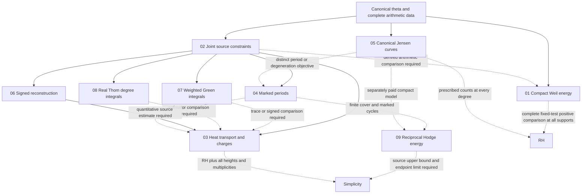

# Compact geometry, heat transport and Weil positivity: research program

21 October 2026, America/New_York. Prepared for **Edward Baker** with
substantial LLM assistance. Actual recorded model **gpt-6-astra (Codex)**,
reasoning effort **ultra**, verified from this chat’s active turn metadata.

**Classification: research program with bounded round-1 results.**
This implements the [continuation prompt][prompt] from the [opening
brainstorm][brainstorm]. The [result index][results] and [avoid index][avoid]
are mandatory entry points; specific clusters and patterns are linked below.
Source notes and their latest progress records prevail over summaries.
The [shared register][progress] separates inherited work from all new tasks.

## 1. Targets, common source and parameters

The complete physical field is
\[
 H(t,z)=\int_0^\infty\Phi(u)e^{tu^2}\cos(zu)\,du,
 \qquad H_t=-H_{zz},\qquad
 H(0,z)=\tfrac18\xi(\tfrac12+iz/2).
\]
Its canonical theta source, full modular reflection and complete transform
supply common arithmetic data. The complete Weil form is a different
observation of arithmetic data, retaining the gamma, pole and prime terms
together. Any map between these observations must be derived with its
normalization; sharing a source does not transfer a sign automatically.

| Target | Required quantifiers | Present meaning |
| --- | --- | --- |
| RH via Weil | Q_{0,L}[f]>=0 for every L>0 and every complex smooth compact test in the interval | Global equivalent criterion; no all-support theorem is supplied here. |
| RH via canonical Jensen topology | For f_J(s)=xi(1/2+sqrt(s))=sum gamma_k s^k/k!, J_d(X)=sum binom(d,k)gamma_k X^k, the smooth projective normalization C_g of y²=J_{2g+1}(x) has b_0(C_g(R))=g+1 for every g>=1 | [Inherited equivalent criterion][surfaces]; uses original degree 2g+1, even when normalization lowers genus. |
| Simplicity conditional on RH | Exclude every endpoint multiple zero at every height and every multiplicity | Stronger target. Ordinary-double windows, strict finite Jensen hyperbolicity and RH alone do not settle it. |
| Estimating milestone | A strictly better signed lower endpoint or strictly contained complete interval; separately, a proved acquisition benefit on a declared comparison class | Useful even if zero remains in the interval; no exclusion is then claimed. |

The square-root expression for f_J denotes its single-valued even power
series. Neither complex genus alone nor the genus of a normalized singular
fiber can replace the prescribed real-component condition. By [avoid 01][a01],
the two RH reformulations are targets, not milestones to support by checks.

| Symbol | Parameter | What must not be identified with it |
| --- | --- | --- |
| t, T | Physical theta heat time and finite reconstruction time | Zeta shift, support length, or auxiliary polynomial heat |
| sigma | Auxiliary polynomial heat parameter when discussing the Jensen hierarchy | Physical theta heat time; use a different symbol for any reconstruction lower-time cutoff |
| L | Total test-support length, e.g. (-L/2,L/2) | Circle circumference P or Fourier resolution N |
| P, j | Compact-circle size and approximation-family index | Support length of a fixed embedded test |
| m | Canonical source cutoff, always with its entire omitted tail | Curve degree or a claim that the finite head is the full source |
| N | Spectral/Fourier resolution | Physical cutoff, support or degree |
| omega | Zeta shift; central form has omega=0 | Heat time |
| d=2g+1 | Original Jensen degree | Normalization genus in a singular fiber |
| delta | CCM threshold depth | An internal root gap or a known physical spectral gap |

For a fixed-test compact limit, hold f and its support fixed as j grows.
A diagonal support/shift limit needs its own proof. Each degree, cutoff,
time or height limit must name its fixed parameters and complete error.

## 2. Inherited evidence and live gates

The [finite-horizon manuscript][weil] certifies the complete complex-input
form through L=log 7, including the infinite-dimensional tail and head–tail
couplings; its [status][weil-status] remains a working draft without human
specialist review or formal verification. [Cluster 02][finite] also routes
to later finite storage-depth certificates with their distinct caveats.
A finite list of certificates does not give unbounded support. The diagonal
criterion leaves construction of its whole L_j, omega_j sequence open.

[CCM’s current program][ccm-program] records “round 9 completed; bounded
endpoint-energy route obstructed, one-sided threshold inequality still
open.” The obstruction concerns the **bare archimedean energy norm** and
negative-side divergence of a signed operator. It does not disprove the
needed upper inequality or all compact models. Automatic fixed-L enlargement
is suspended; ground overlap and determinant-limit identification remain
unproved; Sonin residuals remain deferred. [Cluster 08][ccm-summary] is an
index, while [round 9][ccm-obstruction] fixes the current scope.

[BW12 FTSR][ftsr-progress] has a paid conditional ordinary-double window,
complete signed linear/quadratic response, rank at most four, and a canonical
covariance refinement. The J^-3+J^-4 error beats its specified common-grid
J^-1 range enclosure when 2(epsilon_J+a_J)<c*/J, with extra cell moments
and complete payments. Direct
use of the same moments gives the same improvement. Positive-time advantage
and a positive complete endpoint lower bound remain unestablished;
FTSR-06 is Gated and FTSR-07 is Gated; not achieved. Parent [ECE gates][ece-progress]
remain open/gated as recorded there. [Notes 16–19][n16] interpret and connect
these results without upgrading them.

[BW14][bw14-progress] includes the complete-tail Laplace law, coupled jet
allowances and **Note 05** full-reflection stability. Its moving-disk error
is small relative to a gamma envelope, not to a nonvanishing physical field
or jet. TST-03 remains partial and TST-05 gated. The exact shifted comparator
already removes the connector; more connector orders do not themselves
provide a retained-core sign.

[BW13][bw13-progress] proves a local nodal-period variation with a complete
source-tail interface, but the first correction is determined by the event
four-jet. That same-information coefficient comparison is stopped; finite
non-asymptotic or additional-source period estimates remain open. [BW15][bw15-progress]
retains a sharper sufficient-degree bound and finite certificates, while
its selected fresh-acquisition single-disk speed comparison failed and is
stopped. It remains in reserve pending a distinct useful objective.
These sources retain their original internal review scopes; this synthesis
is not an independent mathematical validation.

## 3. Connections and dependency map

Arrows between directions are proposed transfers of **paid information**,
not proved sign implications. W can start from the complete Weil identity
without waiting for all source/geometry work. A supplies the next common
estimating priority; R is one consumer, not an independent duplicate
source program. H can use a successful signed source bound or a genuinely
new all-face flux estimate. P and J need a separate numerical or analytic
benefit before activation. Their folders are reserve homes, not permissions
to rerun completed comparisons.

| Direction | Exact missing input | First bounded deliverable and dependency |
| --- | --- | --- |
| [01 Compact Weil][p1] | Independent positivity and one-sided comparison with the **complete** arithmetic form | I4-W01: one candidate, source map, signed discrepancy and estimate or scoped failure; begins from Note 19 and CCM. |
| [02 Source constraints][p2] | A theta-specific joint restriction with a signed consequence after the entire tail and matching conditions | I4-S01: a feasible set for the few response measurements and a matched lower-endpoint comparison; uses BW14 and BW12 Notes 13–15. |
| [03 Heat/charges][p3] | Source-paid control on a whole swept boundary or its complete signed flux, without assuming the unknown internal gap | I4-H01: one finite boundary/flux comparison; gated on an identified payable estimate. |
| [04 Periods][p4] | A quantitative marked-period restriction outside the already determined four-jet | I4-P01: one finite-period or coupled-cycle contract and direct comparator; gated on distinct information/benefit. |
| [05 Jensen][p5] | A canonical-source estimate on degeneration, periods or all-degree real topology | I4-J01: one distinct observable and degree/error contract; reserve pending benefit beyond the stopped single-disk test. |
| [06 Reconstruction][p6] | A new finite-time approximation with paid full-line and defect errors that improves the matched direct method | I4-R01: one bounded candidate comparison; gated, with I4-S01 preferred first. |
| [07 Weighted Green][p7] | Coupled signed log-energy control for a specified weighted completed Gauss target | WGI-01: define one weight/domain/error consumer and equally informed direct comparator; Unstarted. |
| [08 Real Thom/degree][p8] | Source-paid signed localized determinant enclosure with a paid external jet floor | RTD-01: specify one real domain and cutoff/Gaussian comparison with complete winding; Unstarted. |
| [09 Reciprocal Hodge energy][p9] | A complete energy/dual-period upper bound with every boundary and endpoint cost | RHE-01: choose one finite cover and compare reciprocal-energy acquisition with direct integration; Unstarted. |

## Additional integral-project organization — 22 October 2026

Prepared for Edward Baker with substantial LLM assistance; actual recorded
**gpt-6.1-sol (Codex), reasoning effort ultra**, verified from this turn's
metadata. The [survey][formula-survey] selects three focused directions
beyond the completed global inverse-Schur comparison. The new homes have
their own [WGI][wgi-progress], [RTD][rtd-progress] and [RHE][rhe-progress]
registers. These are the sole owners of their local task IDs; the parent
register retains only cross-program summaries. Setup is organizational;
no new analytic bound, numerical acquisition or inherited-gate upgrade is
recorded by creating them.

WGI studies weighted Green localization of the completed spatial jet
measure, retaining its common-zero atoms and sign-changing log payments.
It can supply a localized result to CHB-07 if its matched comparison
succeeds; it does not repeat shared Note 05's failed global certificate.
RTD studies an exact real degree representative and a paid Gaussian
boundary correction, with acquisition versus complete winding as its
first objective. It is another representative of the existing index.
RHE studies the full energy of dz/sqrt(H), rather than the already recorded
reciprocal cycle period or stopped first four-jet coefficient. Capacity
and collar modulus are supporting tools within RHE, not a fourth project.

Home 02 supplies complete source data to all three. Homes 04–05 retain
their existing period/Jensen gates; a possible RHE model does not unlock
them. A weighted spatial estimate does not control a real critical-wall
trace without another proved comparison. A real domain with t>0 does
not count an endpoint event at t=0. Finite reciprocal energy for each
t>0, or finite-degree Jensen strictness, does not pay a uniform limiting
bound. Preserve the [survey's control screen][formula-survey] and all
original scopes.

## Current result — 21 October 2026

I4-W01’s first candidate analysis is complete. The [circle note][round1]
proves a complete fixed-test comparison with an exponentially small signed
image error, but its literal form is not positive in the stated regime.
The positive jump completion pays a nonvanishing scalar/pole defect;
specified fixed-rank and diagonal repairs also fail. Its [review][round1-review]
records the scope and corrections. I4-W02 remains gated; this does not
exclude a different non-diagonal arithmetic construction.

The [zero-following screen][wall-screen], prompted by the user, completes
I4-H00 only. Phase-wall cancellation is inherited; scalar energy also loses
its boundary terms, while cap information and jet flux remain. I4-H01 is
still gated. **I4-S01 is now the next priority.** Sections 4–5 retain the
original contracts and order that governed the first research round.

The **22 October interior-current follow-up** refines the user’s boundary
proposal: [Note 02][interior-current] proves that two scalar-current paths
surviving backward inside the same gap would prevent its collapse under
the inherited Laguerre sign. It does not prove that survival for theta.
Phase trapping alone remains compatible with an ordinary double. This
supplies a concrete possible I4-S01 consumer: a complete-source survival
or critical-amplitude bound, compared with direct endpoint information.
No source or full-boundary gate is upgraded.

The user-requested [dedicated ICW overview][icw-program] and
[progress register][icw-progress] now develop this interior-current proposal;
use the [new-session prompt][icw-prompt] for continuation. Their creation
changes task organization, not the existing mathematical status.

## 4. First priority: the complete compact Weil comparison

Following [Note 19][n19], seek explicit compact spaces M_j, input maps I_j
and energies E_j, independently nonnegative, such that for every fixed
smooth compact complex f,
\[
 Q_0[f]\ge E_j[I_jf]-\varepsilon_j[f],\quad
 E_j[I_jf]\ge0,\quad \varepsilon_j[f]\ge0,\quad
 \varepsilon_j[f]\longrightarrow0.
\]
This is the target contract, not a new estimate. Exact convergence to Q_0
would be stronger. No positive gap uniform in j or convergence uniform
for tests with growing support is required. A bound epsilon_{j,L}||f||_X²
is useful only with the norm and fixed-L convergence justified.

**I4-W01** first selects one actual candidate and writes
D_j[f]=Q_{0,L}[f]-E_j[I_jf]. The ledger must include gamma, both pole
contributions, every active prime-power translation, seam changes, input-map
and projection errors, source/spectral truncation, and any limiting error.
The requested first result is a justified lower bound for D_j or a scoped
obstruction. Neither a renamed finite positive pencil nor subtraction of
its lowest eigenvalue settles the scalar correction back to Q_0.

A literal interval-delay periodization must retain Note 19’s correction
\[
 \delta Q_a[f]=-2c_a\Re\int_0^a\overline{f(x)}f(x-a+P)\,dx.
\]
Paired endpoint collars give both signs. Avoiding finitely many seams
for a fixed test does not prove positivity of the compact energy or control
a growing prime family and gamma/pole changes. A periodic basis for the
original interval form preserves these terms. The control is not an
allegation that CCM omitted them. Compare against the original complete
form with the same inputs and resolution. Stop the chosen candidate if
its comparison rests on an assumed target sign or an unavailable absolute
endpoint bound; record that exact class rather than excluding all geometry.
Only a useful bounded comparison unlocks I4-W02, the quantified fixed-test
family and all-support assembly.

## 5. Second priority: coupled source information and signed response

For the canonical source Phi=S_m+R_m, complete reflection couples its head
and tail:
\[
 S_m(v)-S_m(-v)=-\{R_m(v)-R_m(-v)\}.
\]
They are not separately even. [BW14 Notes 04][tail] and [05][reflection]
provide actual-law bounds and finite-reflection stability; [BW12 Note 16][n16]
selects their joint use with the response quotient.

For a paid two-root window and complete field H=F+E,
\[
 \Delta_H=\Delta_F+L_F(E)+B_F(E,E)+R_3,
 \qquad |R_3|\le C_3(\rho),\quad\sup_\Gamma|E/F|\le\rho<1.
\]
The quadratic response is l^T d+d^T M d with at most four real residual
coordinates. Compression does not remove R_3. **I4-S01** must acquire a
new joint constraint on those coordinates from unchanged canonical data,
full reflection and, at a putative event, simultaneous value/derivative
matching. For a shifted reference, use the exact shifted head P_m and its
same complete tail, then rebuild the contour, residual, connectors, counts
and wall ratio; do not transplant an unshifted residual formula.

Compare the full lower endpoints against Note 15’s direct covariance
estimator supplied the **same** added information and acquisition accuracy.
A strict improvement can be useful while still containing zero; a sign
claim additionally needs the complete lower endpoint positive on the stated
domain. At a hypothetical double the inherited head–tail cancellation
allows the exact answer to be zero, so refinement alone cannot contradict
it. Stop if the new condition only reproduces the existing feasible set,
if it uses a presumed gap, or if it merely repeats connector stability.

## 6. Reserve geometry and transport tasks

**Physical heat and charge.** For G=(H,H_z), g=G/||G|| and A=-i g*dg,
[Notes 17][n17] and [18][n18] give the phase connection and its heat
variation. Its real-plane phase form vanishes, while real winding and
complex Hopf charge are different observations. Complex event weight is
m(m-1)/2; real collision-count weight is floor(m/2), with orientation
specified in the source. A closed-boundary charge is conserved only when
the entire swept boundary avoids common zeros. The complete face equation
retains late, early, imaginary-time and spatial-wall terms. A later simple
real slice is not a proved zero-charge complex boundary. A nonvanishing
second four-ball cap in the same trivial bundle already requires zero
boundary degree; that scoped cap cannot be assumed. I4-H01 must pay an
estimate beyond these identities. I4-H02 retains all-height and
higher-multiplicity obligations and stays gated.

**Periods.** The direct cover w²=H(t,z) needs a finite spatial boundary and
regular marked transport paths. Root-permutation monodromy and homology
monodromy are distinct; a local annulus Dehn twist fixes its absolute H_1
generator. Moving a loop’s base point preserves its marked conjugacy
class, not permission to replace the loop by one in a late regular region.
A cycle can persist while its period vanishes. I4-P01 must specify a
finite-time/global-source observable beyond the first four-jet correction,
its differential, cycles, remainders and matched direct estimate. Stop if
it reduces to the existing coefficient identity or assumes an unpaid
nondegeneration floor. No compactification of the full entire cover or
finite global genus budget is assumed.

**Jensen curves.** [Notes 05][surfaces] and [07][deficit] supply compact
real curves and the deficit identity. Normalization preserves a smooth
individual curve but can lose genus; it need not produce a smooth family
through degeneration. Auxiliary polynomial heat eventually regularizes
each fixed polynomial; a uniform degree condition is already an RH
criterion. I4-J01 must name a distinct period, degeneration or explicitly
amortized multi-window objective before coefficient acquisition, preserving
complete tails and rounding. I4-J02, a canonical all-degree topology bound,
remains gated. Finite strict hyperbolicity never licenses limiting simplicity.

**Finite-time reconstruction.** I4-R01 may use a new approximation P(t,y)
only with terminal full-line residual, heat defect, integration-by-parts
boundaries and endpoint contour error all paid. [Note 16][n16] supplies
the accounting template; exact canonical-cell evolution and Hermite
projection already reconstruct their direct endpoint approximations.
A growing-time campaign remains gated by FTSR-06. The direct endpoint
route and I4-S01 have priority; a new representation alone does not change
available information.

## 7. Shared controls and acceptance rules

These are inherited screens to apply to each future candidate, not newly
rerun experiments. [Cluster 12][controls] fixes each preservation list;
[avoid 02][a02] requires naming a failed premise and where it enters the
estimate. An arithmetic difference is not itself a quantitative discriminator.

| Control | What it preserves/tests | Premise absent or conclusion limited |
| --- | --- | --- |
| H=z²-2t | Regular forced discriminant transport and charge-one collision | No canonical theta source. Regular transport alone cannot exclude its event. |
| H_C=z²-2t-C/4, C>=0 | Same regular positive-time topology for endpoint double or separated pair | No canonical theta arithmetic; complete signed return still retains C. |
| Paired seam collars | Literal periodization discrepancy has opposite signs | Rules out universal one-sided **prime-term** comparison for that replacement, not every complete compact construction. |
| f_*(s)=(1+s)sinh(pi sqrt(s))/(pi sqrt(s)) | Strict finite Jensen hyperbolicity despite a limiting double | Not the canonical theta coefficient sequence; no positive theta heat source is asserted. |
| Euler-factor sources | Several theta-like analytic/arithmetic features with collisions | Changed canonical arithmetic. |
| Weighted-square / finite-prime sources | Square support or selected identities and finite measurements | Lack the complete normalized reflection conjunction; finite-prime matching can persist at escaping heights. |
| Reflected / positive-primitive sources | Full reflection or strong primitive constraints in their own classes | Lack canonical square coefficients; do not merge separate preservation lists. |
| Canonical-cell, Hermite and covariance comparisons | Exact reconstruction and same-data direct comparison | Extra moments must be disclosed; generic enclosure gains do not imply an endpoint sign. |

Each new note must identify object, domain, normalization, claimed class,
input information, signed output, every error, direct comparator, controls
and review scope. Preserve mixed head–tail terms, outer-wall versus internal-gap
distinctions and all cap/seam/boundary contributions. Use [avoid 03][a03]
for re-realizations, [07][a07] for scoped exclusions, [12][a12] for coupled
estimates, [13][a13] for the full target and [15][a15] for sibling stops.
[Clusters 13][geometry], [14][arithmetic] and [16][connections] route to
the relevant inherited identities. Organization alone warranted no new
result entry; the bounded round-1 findings are now indexed with their scope.

## 8. Deliverable discipline and unresolved inputs

The six READMEs specify their bounded contracts; the [register][progress]
is the portfolio task ledger. The user-requested [ICW register][icw-progress]
owns the dedicated interior-current task IDs. Research goes in each home’s notes/, small
computations in numerics/, and assessments in reviews/. Follow the
[large-file policy][large] and [chat-history workflow][history-policy].
Do not copy earlier manuscripts or create snapshot folders.

The positive candidate tested in round 1 fails its vanishing-error
comparison; a successful independently positive compact family remains open. No new theta-specific signed
feasible set, boundary floor, period inequality or all-degree estimate
has been obtained. These are mathematical dependencies for the registered
tasks, not missing organizational files. Historical statements retain
source review limits; specialist validation and any literature/novelty
review needed for a later claim are not supplied by this synthesis.

[a01]: ../../../avoid/01_restating_the_target.md
[a02]: ../../../avoid/02_shape_only_arguments_and_the_controls.md
[a03]: ../../../avoid/03_lifts_and_re_realizations_in_new_coordinates.md
[a07]: ../../../avoid/07_scoped_exclusions_read_as_universal.md
[a12]: ../../../avoid/12_term_by_term_matching_and_separate_bounds.md
[a13]: ../../../avoid/13_a_factor_is_not_the_target.md
[a15]: ../../../avoid/15_ignoring_sibling_results_and_unfinished_closures.md
[arithmetic]: ../../../result-summaries/14_theta_identities_and_arithmetic_bookkeeping.md
[avoid]: ../../../avoid/README.md
[brainstorm]: ../brainstorm/01_COMPACT_GEOMETRY_HEAT_TRANSPORT_AND_WEIL_POSITIVITY_20261021.md
[bw13-progress]: ../../investigations-3/13_contradiction_analysis/04_boundary_winding/threshold_routes/13_spectral_covers_and_periods/research-progress/01_SPECTRAL_COVERS_AND_PERIODS_PROGRESS_20261021.md
[bw14-progress]: ../../investigations-3/13_contradiction_analysis/04_boundary_winding/threshold_routes/14_theta_source_transform_constraints/research-progress/01_THETA_SOURCE_TRANSFORM_CONSTRAINTS_PROGRESS_20261021.md
[bw15-progress]: ../../investigations-3/13_contradiction_analysis/04_boundary_winding/threshold_routes/15_jensen_surface_degeneration/research-progress/01_JENSEN_SURFACE_DEGENERATION_PROGRESS_20261021.md
[ccm-obstruction]: ../../investigations/ccm-operator-realizations/notes/CCM_THRESHOLD_ENERGY_OBSTRUCTION_20260928.md
[ccm-program]: ../../investigations/ccm-operator-realizations/PROGRAM_OVERVIEW.md
[ccm-summary]: ../../../result-summaries/08_character_channels_ccm_and_detector.md
[connections]: ../../../result-summaries/16_hypercomplex_reductions_and_geometric_realizations.md
[controls]: ../../../result-summaries/12_collision_controls_and_screening.md
[deficit]: ../../investigations-2/active/22_theta_manifold_geometry/notes/01_physical_jet_geometry/07_REAL_PROJECTIVE_JETS_AND_JENSEN_HEAT_SURFACES_20261015.md
[ece-progress]: ../../investigations-3/13_contradiction_analysis/04_boundary_winding/threshold_routes/12_relative_chern_hopf_charges/research-progress/02_ENDPOINT_CHARGE_EXCLUSION_PROGRESS_20261021.md
[finite]: ../../../result-summaries/02_finite_horizon_certificates.md
[ftsr-progress]: ../../investigations-3/13_contradiction_analysis/04_boundary_winding/threshold_routes/12_relative_chern_hopf_charges/research-progress/03_FINITE_TIME_SIGNED_RECONSTRUCTION_PROGRESS_20261021.md
[geometry]: ../../../result-summaries/13_local_heat_flow_geometry_and_rh_equivalent_criteria.md
[history-policy]: ../../../tools/CHAT_HISTORY.md
[large]: ../../../LARGE_FILES.md
[n16]: ../../investigations-3/13_contradiction_analysis/04_boundary_winding/threshold_routes/12_relative_chern_hopf_charges/notes/16_HIGH_LEVEL_INTERPRETATION_AND_RESEARCH_DIRECTIONS_20261021.md
[n17]: ../../investigations-3/13_contradiction_analysis/04_boundary_winding/threshold_routes/12_relative_chern_hopf_charges/notes/17_PARALLEL_TRANSPORT_CONNECTIONS_AND_COLLISION_CONTROLS_20261021.md
[n18]: ../../investigations-3/13_contradiction_analysis/04_boundary_winding/threshold_routes/12_relative_chern_hopf_charges/notes/18_HEAT_EVOLUTION_AND_EARLY_LATE_TOPOLOGICAL_TRANSPORT_20261021.md
[n19]: ../../investigations-3/13_contradiction_analysis/04_boundary_winding/threshold_routes/12_relative_chern_hopf_charges/notes/19_COMPACT_SURFACE_SEQUENCES_AND_WEIL_POSITIVITY_20261021.md
[p1]: ../01_compact_weil_positivity/README.md
[p2]: ../02_theta_source_constraints/README.md
[p3]: ../03_heat_transport_and_charges/README.md
[p4]: ../04_spectral_covers_and_periods/README.md
[p5]: ../05_compact_jensen_surfaces/README.md
[p6]: ../06_signed_reconstruction/README.md
[progress]: ../research-progress/01_COMPACT_GEOMETRY_HEAT_TRANSPORT_AND_WEIL_POSITIVITY_PROGRESS_20261021.md
[prompt]: ../brainstorm/02_CONTINUATION_PROMPT_FOR_RESEARCH_PROGRAM_AND_FOLDERS_20261021.md
[reflection]: ../../investigations-3/13_contradiction_analysis/04_boundary_winding/threshold_routes/14_theta_source_transform_constraints/notes/05_FINITE_REFLECTION_JETS_AND_HEAD_TAIL_STABILITY_20261021.md
[results]: ../../../result-summaries/README.md
[surfaces]: ../../investigations-2/active/22_theta_manifold_geometry/notes/01_physical_jet_geometry/05_JENSEN_HYPERELLIPTIC_TOPOLOGY_20261015.md
[tail]: ../../investigations-3/13_contradiction_analysis/04_boundary_winding/threshold_routes/14_theta_source_transform_constraints/notes/04_CANONICAL_TAIL_LAPLACE_CONSTRAINT_AND_COUPLED_ENCLOSURE_20261021.md
[weil]: ../../weil-positivity/shifted-zeta/weil-depth/manuscript/finite_horizon_weil.tex
[weil-status]: ../../weil-positivity/shifted-zeta/weil-depth/STATUS.md
[round1]: ../01_compact_weil_positivity/notes/01_CIRCLE_COMPARISON_AND_POSITIVE_COMPLETION_OBSTRUCTIONS_20261021.md
[round1-review]: ../01_compact_weil_positivity/reviews/01_CIRCLE_COMPARISON_REVIEW_20261021.md
[wall-screen]: ../03_heat_transport_and_charges/notes/01_ZERO_FOLLOWING_BOUNDARIES_AND_REMAINING_FLUX_20261021.md
[wall-review]: ../03_heat_transport_and_charges/reviews/01_ZERO_FOLLOWING_BOUNDARY_REVIEW_20261021.md
[round1-check]: ../01_compact_weil_positivity/numerics/CIRCLE_COMPARISON_CHECK_20261021.json
[interior-current]: ../03_heat_transport_and_charges/notes/02_INTERIOR_CURRENT_WALLS_AND_BACKWARD_SURVIVAL_20261022.md
[interior-review]: ../03_heat_transport_and_charges/reviews/02_INTERIOR_CURRENT_WALL_REVIEW_20261022.md
[icw-program]: ../research-overview/02_INTERIOR_CURRENT_BOUNDARIES_AND_BACKWARD_SURVIVAL_PROGRAM_20261022.md
[icw-progress]: ../research-progress/02_INTERIOR_CURRENT_BOUNDARIES_AND_BACKWARD_SURVIVAL_PROGRESS_20261022.md
[icw-prompt]: ../brainstorm/03_CONTINUATION_PROMPT_INTERIOR_CURRENT_BOUNDARIES_20261022.md
## ICW research update — 22 October 2026

Prepared for Edward Baker with substantial LLM assistance; **gpt-6-astra,
effort ultra**. ICW-02 is complete for the [terminal-floor candidate][contract],
whose same-data direct comparison fails. Its ordinary-double survivor-width
bound is a local conditioning result, not a theta exclusion. The user
clarified that simplifying integrals related to topology is independently
valuable. [ICW-07][icw-progress] now records the [finite real-phase reduction][boundary-reduction],
with remaining caps and the separate BW10/BW12 complex-boundary form explicit.
The direct ancestors are [BW10 signed tubes][bw10-tubes] and
[multiplicity-selective Chern/Hopf observations][bw10-chern], and
[BW12 all-face heat transport][bw12-transport]. The full complex boundary,
quantitative theta survival and all-height/multiplicity conclusions remain
unpaid. I4-S01's new signed source restriction is still unstarted.
See the [internal review][pilot-review]; no theta numerical acquisition.

[contract]: ../03_heat_transport_and_charges/notes/03_SCALAR_SOURCE_CONTRACT_AND_SURVIVOR_WIDTH_20261022.md
[boundary-reduction]: ../03_heat_transport_and_charges/notes/04_PHASE_BOUNDARY_REMOVAL_AND_CAP_REDUCTION_20261022.md
[pilot-review]: ../03_heat_transport_and_charges/reviews/03_SOURCE_CONTRACT_SURVIVOR_AND_BOUNDARY_REVIEW_20261022.md
[pilot-check]: ../03_heat_transport_and_charges/numerics/ICW_ANALYTIC_CHECKS_20261022.json
[bw10-program]: ../../investigations-3/13_contradiction_analysis/04_boundary_winding/threshold_routes/10_rh_implies_simple_zeros/research-overview/02_HEAT_ROOT_MOTION_AND_SIGNED_CONTOURS_PROGRAM_20261021.md
[bw10-progress]: ../../investigations-3/13_contradiction_analysis/04_boundary_winding/threshold_routes/10_rh_implies_simple_zeros/research-progress/02_HEAT_ROOT_MOTION_AND_SIGNED_CONTOURS_PROGRESS_20261021.md
[bw10-tubes]: ../../investigations-3/13_contradiction_analysis/04_boundary_winding/threshold_routes/10_rh_implies_simple_zeros/notes/21_MOVING_SIGNED_TUBES_AND_PHYSICAL_TRACE_20261021.md
[bw10-chern]: ../../investigations-3/13_contradiction_analysis/04_boundary_winding/threshold_routes/10_rh_implies_simple_zeros/notes/25_MULTIPLICITY_SELECTIVE_CHERN_AND_HOPF_OBSERVATIONS_20261021.md
[bw12-connection]: ../../investigations-3/13_contradiction_analysis/04_boundary_winding/threshold_routes/12_relative_chern_hopf_charges/notes/17_PARALLEL_TRANSPORT_CONNECTIONS_AND_COLLISION_CONTROLS_20261021.md
[bw12-transport]: ../../investigations-3/13_contradiction_analysis/04_boundary_winding/threshold_routes/12_relative_chern_hopf_charges/notes/18_HEAT_EVOLUTION_AND_EARLY_LATE_TOPOLOGICAL_TRANSPORT_20261021.md
[bw12-progress]: ../../investigations-3/13_contradiction_analysis/04_boundary_winding/threshold_routes/12_relative_chern_hopf_charges/research-progress/03_FINITE_TIME_SIGNED_RECONSTRUCTION_PROGRESS_20261021.md
## Chern/Hopf boundary continuation — 22 October 2026

Prepared for Edward Baker with substantial LLM assistance; **gpt-6-astra,
effort ultra**. The user-requested [dedicated overview][chb-overview] and
[plan][chb-plan] make exact integral simplification an independent objective
continuing BW10/BW12. Shared I4 notes now prove projective-side cancellation,
radial cap formulas and [physical heat-face reduction to a critical-value
phase trace][chb-local], with conditional source-chart contracts. The
subsequent [complete physical boundary][chb-complete] now assembles both
charts and all faces into the critical-value winding, with explicit
parameterized geometry, boundary floor and regulator allowance. Its wall
flux is generally nonzero; the separate integral cancels in the assembly.
[Topological mass bounds][chb-bounds] establish bounded-weight estimates
and a fixed-delta Gauss-area comparison, retaining the inverse delta cost.
CHB-07 seeks a useful target-integral estimate independently of simplicity;
actual theta acquisition and a useful canonical comparison remain open.
I4-H01's canonical quantitative gate and I4-H02 remain unchanged. See the
[complete-boundary internal review][chb-review5].

[chb-overview]: ../10_chern_hopf_integral_estimates/research-overview/01_CHERN_HOPF_INTEGRAL_ESTIMATION_PROGRAM_20261022.md
[chb-plan]: ../10_chern_hopf_integral_estimates/research-progress/01_CHERN_HOPF_INTEGRAL_ESTIMATION_PROGRESS_20261022.md
[chb-local]: ../notes/02_CHERN_HOPF_PHYSICAL_TIME_SECTOR_REDUCTION_20261022.md
[chb-review]: ../03_heat_transport_and_charges/reviews/04_CHERN_HOPF_BOUNDARY_OPENING_REVIEW_20261022.md
[chb-complete]: ../notes/03_COMPLETE_PHYSICAL_BOUNDARY_AND_CRITICAL_VALUE_WINDING_20261022.md
[chb-bounds]: ../notes/04_TOPOLOGICAL_MASS_BOUNDS_AND_INDEX_THEOREM_INTERFACE_20261022.md
[chb-review5]: ../03_heat_transport_and_charges/reviews/05_COMPLETE_BOUNDARY_AND_INTEGRAL_BOUNDS_REVIEW_20261022.md
[formula-survey]: ../brainstorm/05_BROAD_SURVEY_OF_TOPOLOGICAL_INTEGRAL_FORMULAS_FOR_RH_AND_SIMPLICITY_20261022.md
[p7]: ../07_weighted_green_integrals/README.md
[p8]: ../08_real_thom_degree_integrals/README.md
[p9]: ../09_reciprocal_hodge_energy/README.md
[wgi-progress]: ../07_weighted_green_integrals/research-progress/01_WEIGHTED_GREEN_INTEGRALS_PROGRESS_20261022.md
[rtd-progress]: ../08_real_thom_degree_integrals/research-progress/01_REAL_THOM_DEGREE_INTEGRALS_PROGRESS_20261022.md
[rhe-progress]: ../09_reciprocal_hodge_energy/research-progress/01_RECIPROCAL_HODGE_ENERGY_PROGRESS_20261022.md
